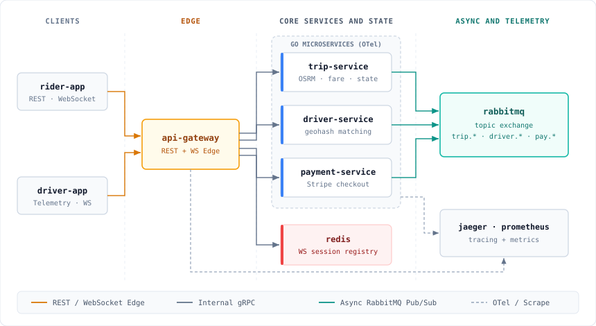
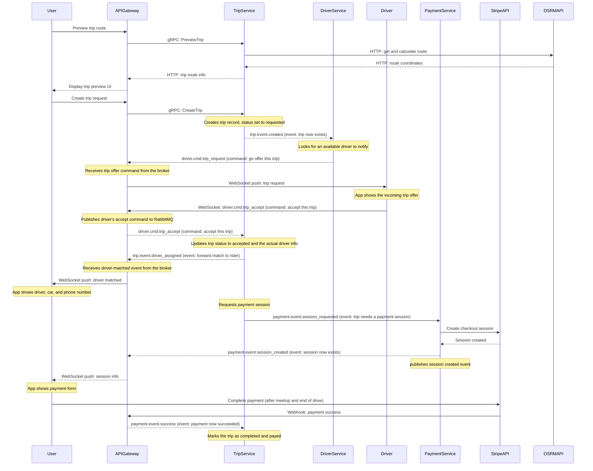

# Addis Ride

Addis Ride is an event-driven microservices ride-hailing platform designed for real-time driver matching, trip routing, and asynchronous payment settlement.

---

## System Architecture

The architecture uses an API Gateway serving client applications over REST and WebSockets, internal microservices communicating via gRPC, and an asynchronous messaging backbone powered by RabbitMQ topic exchanges.


---

## Trip & Payment Lifecycle Flow

End-to-end request flow tracing a trip from rider request through driver acceptance to payment—showing how the trip service, driver matching engine, notification service, and payment gateway coordinate across gRPC calls and event streams.



## Deep Dive: The Driver Matching Engine

A real-time matching engine for a ride-sharing service. It keeps every driver's location in memory, finds the nearest free drivers, makes sure no driver is ever booked twice, and offers trips to drivers with timeouts and cancellation.

It handled **100,000 drivers sending a location update every 4 seconds (about 25,000 updates per second)** and **about 8,000 ride requests per second** on a 4-core laptop, with no double bookings. When overloaded, it turns requests away instead of falling over.

[Demo video](#) (the real engine, with simulated drivers and riders)

The engine runs inside the driver service of the ride-sharing microservice system.

## What it does

```
location updates ──> [ geo-index: drivers in map cells, split across shards ]
                                      ^
ride request ──> [ bounded queue ] ──> [ workers ] ──> search nearby cells ──> reserve one driver (atomic)
                                                                                      |
                                                       [ one goroutine per trip ] <───┘
                                                       offers the trip, waits for: answer | timer | rider cancel
                                                       decline or timeout: free the driver, offer the next closest
```

| Part | Package | What it solves |
|---|---|---|
| Geo-index | `internal/index` | Many readers and writers at once without lock contention |
| Location updates | `internal/index` | Moving a driver between cells without anyone seeing them twice or not at all |
| Nearest-driver search | `internal/index` | Finding the 5 closest free drivers without scanning every driver |
| Reservation | `internal/index` | No double booking when many requests race for the same driver |
| Request queue and workers | `internal/matcher` | Bounded memory and steady latency under traffic spikes |
| Offer manager | `internal/offer` | Silent drivers, declines and rider cancels, without leaving drivers stuck |

## How each part works

### 1. Geo-index

Drivers are stored in map cells (geohash, precision 6, about 1.2 km by 0.6 km). Two maps are kept, both split into shards that each have their own read-write lock:

- cell to the drivers in it
- driver to the cell they are currently in (so moving or removing a driver is one lookup, not a scan of every cell)

Locks are always taken in the same order: driver shard first, then cell shards in ascending order. That rules out deadlocks.

### 2. Location updates

A driver who stays in the same cell is overwritten in place. A driver who crosses into a new cell locks **both** cell shards at once, so a reader never sees the driver in two cells or in none. Updates only touch drivers that already exist, so a late update can never bring back a driver who just disconnected.

**Hammering test** (the code called as fast as it can, 8 goroutines, median of 5 runs; [raw output](test-results/bench_go_index.txt)):

| Shards | Update time per op | Updates per second | Speed-up vs 1 shard |
|---|---|---|---|
| 1 | 3,610 ns | 277,000 | 1.0x |
| 16 | 3,188 ns | 314,000 | 1.1x |
| 64 | 967 ns | 1,034,000 | 3.7x |
| 256 | 571 ns | 1,753,000 | 6.3x |

With 80% updates and 20% reads at the same time: 4,153 ns (1 shard), 1,246 ns (64 shards), 786 ns (256 shards), which is 5.3x faster with 256 shards. The 16-shard run was noisy (1,963 to 3,748 ns across runs).

**Realistic test** (every driver sends one update every 4 seconds for 60 seconds; [raw output](test-results/go_ingestion.jsonl)):

| Drivers | Shards | Updates/s | p50 | p95 | p99 | Peak memory |
|---|---|---|---|---|---|---|
| 10,000 | 1 | 2,495 | 4.1 µs | 16.3 µs | 29.5 µs | 25 MB |
| 10,000 | 256 | 2,495 | 9.6 µs | 13.1 µs | 46.8 µs | 25 MB |
| 50,000 | 1 | 12,277 | 4.0 µs | 16.7 µs | 129 µs | 119 MB |
| 50,000 | 256 | 12,381 | 4.3 µs | 11.9 µs | 29.5 µs | 112 MB |
| 100,000 | 1 | 24,392 | 4.0 µs | 229.7 µs | **26.1 ms** | 229 MB |
| 100,000 | 256 | 24,482 | 4.0 µs | 11.5 µs | **22.4 µs** | 222 MB |

Latency here is the time of one location update call. At 100,000 drivers, sharding cut p99 from 26.1 ms to 22.4 µs. At 10,000 drivers the load is too light for the lock to matter, so the differences there are noise. Every run had 0 errors, and about 5.4% of updates moved a driver into a new cell.

### 3. Nearest-driver search

1. Find the pickup point's cell and scan it, then the ring of cells around it, then the next ring.
2. For each cell, copy out only drivers that are free and have the right car type, then release the lock. The distance math (Haversine) runs after the lock is released, so updates are not blocked.
3. Stop when 5 drivers are found and the 5th is closer than the area already covered (rings scanned times the smaller cell side). Nobody in an unscanned cell can beat it, so the result is exact.

A search is not one snapshot, because drivers keep moving while it runs. A driver can be copied from one cell, move into a cell that has not been scanned yet, and be copied again, so results are de-duplicated by driver ID.

**Hammering test** (median of 3 runs; [raw output](test-results/bench_go_search.txt)):

| Drivers | One goroutine | 8 goroutines, 1 shard | 8 goroutines, 256 shards | Memory per search |
|---|---|---|---|---|
| 10,000 | 150.9 µs | 30.3 µs | 30.2 µs | 19 KB, 36 allocations |
| 50,000 | 171.7 µs | 56.8 µs | 52.7 µs | 60 KB, 30 allocations |
| 100,000 | 327.3 µs | 105.0 µs | 105.0 µs | 133 KB, 34 allocations |

For the 8-goroutine columns the time is total time divided by total searches, not the time of one search: at 100,000 drivers that is about 9,500 searches per second.

With searches **and** location updates running together (80% updates, 20% searches, 100,000 drivers): **52.1 µs per operation with 1 shard, 22.0 µs with 256 shards**, which is about 2.4x faster. The 1-shard runs ranged from 43 to 53 µs.

Searches alone do not benefit from sharding (the middle columns are equal), because readers share the read lock. Sharding only helps when writers are present.

### 4. Reservation (no double booking)

Each driver has one atomic integer for its state: available, reserved, assigned (or offline). Reserving is a compare-and-swap: "if the driver is available, mark them reserved". When many requests race for the same driver, the CPU lets exactly one succeed and the rest move to the next candidate. A search only suggests who looks free; the compare-and-swap decides.

When a driver is removed, the state is set to offline first, so a reservation already in flight fails instead of winning a driver who left.

**Correctness tests (all pass with the race detector):**

- 10,000 requests race for 100 drivers: exactly 100 winners, every driver won exactly once.
- 10,000 attempts on a single driver: exactly 1 winner.
- Many reserve and release cycles: two goroutines never hold the same driver.
- A reservation racing with a removal: no panic, the index stays consistent.

**Hammering test** (median of 3 runs; [raw output](test-results/bench_go_reserve.txt)):

| Benchmark | Time per op | Memory |
|---|---|---|
| Reserve and release, random drivers out of 100,000 | 44.7 ns | 0 allocations |
| Reserve and release, only 100 drivers (heavy collisions) | 70.1 ns | 0 allocations |
| Full match (search, reserve, release), 100,000 drivers, 1 shard | 156.0 µs | 135 KB, 34 allocations |
| Full match, 100,000 drivers, 256 shards | 138.8 µs | 135 KB, 34 allocations |

The atomic reservation costs about 45 ns, which is about 0.03% of a full match. The search is where the time and the memory go.

### 5. Request queue and workers

Ride requests go into a bounded queue (a buffered channel) served by a fixed set of worker goroutines. `Submit` never waits: when the queue is full it returns `ErrQueueFull` at once, so memory stays bounded and the caller can react. A request whose rider already gave up while waiting is skipped, and `Close` drains the queue before stopping.

Go sees 8 hardware threads on this 4-core laptop, so 8 goroutines can run at the same instant. The search is pure CPU work, so 8 workers use the machine fully.

**Hammering test** (8 caller goroutines, median of 3 runs; [raw output](test-results/bench_go_matcher.txt)):

| Setup | Time per request | Requests per second | Memory |
|---|---|---|---|
| No queue (callers search directly) | 129.0 µs | 7,750 | 135 KB, 34 allocations |
| Queue with 1 worker | 548.3 µs | 1,820 | 135 KB, 36 allocations |
| Queue with 8 workers | 128.1 µs | 7,810 | 135 KB, 36 allocations |
| Queue with 32 workers | 128.9 µs | 7,760 | 135 KB, 36 allocations |

The queue adds no measurable cost (2 extra allocations). 32 workers are no faster than 8, as expected for CPU-bound work on 8 threads.

**Realistic test** (requests arrive at a fixed rate for 20 seconds, 100,000 drivers, queue of 1,024; [raw output](test-results/go_matching.jsonl)). Latency is from submit to result for accepted requests, including time waiting in the queue:

| Workers | Requests/s sent | Completed/s | Rejected | p50 | p95 | p99 | Peak memory |
|---|---|---|---|---|---|---|---|
| 2 | 1,000 | 1,000 | 0% | 0.86 ms | 9.6 ms | 14.2 ms | 61 MB |
| 2 | 4,000 | 3,962 | 0.7% | 8.1 ms | 122.6 ms | 349 ms | 66 MB |
| 2 | 8,000 | 3,827 | 51.6% | 262 ms | 333 ms | 1,495 ms | 66 MB |
| 2 | 16,000 | 7,358 | 53.7% | 124.6 ms | 230 ms | 246 ms | 70 MB |
| 8 | 1,000 | 1,000 | 0% | 0.29 ms | 0.58 ms | 1.03 ms | 56 MB |
| 8 | 4,000 | 4,000 | 0% | 0.50 ms | 1.50 ms | 2.42 ms | 67 MB |
| 8 | 8,000 | 7,996 | 0% | 2.13 ms | 13.5 ms | 20.1 ms | 90 MB |
| 8 | 16,000 | 6,869 | 56.8% | 144.2 ms | 178.8 ms | 801 ms | 97 MB |
| 32 | 1,000 | 1,000 | 0% | 0.32 ms | 0.77 ms | 1.60 ms | 58 MB |
| 32 | 4,000 | 4,000 | 0% | 0.53 ms | 1.58 ms | 2.34 ms | 72 MB |
| 32 | 8,000 | 8,000 | 0% | 2.07 ms | 18.7 ms | 28.8 ms | 91 MB |
| 32 | 16,000 | 6,503 | 58.8% | 85.3 ms | 369.8 ms | 801 ms | 108 MB |

What it shows:

- With 8 workers the engine keeps up with **about 8,000 requests per second with no rejections and p99 around 20 ms**.
- At double that load (16,000 per second) it rejects 57% of requests, keeps completing about 6,900 per second, and memory stays around 100 MB. It degrades by turning requests away, not by running out of memory.
- 2 workers saturate around 4,000 per second, and 32 workers behave like 8.

### 6. Offer manager (timeout, decline, cancel)

Each trip gets one goroutine that owns the whole offer. It reserves the nearest driver, sends the offer, then waits on three things at once with `select`: the driver's answer, a timer, and the rider cancelling (a `context`). The first event wins and the others are ignored.

- **Decline or no answer:** the driver is freed, added to an exclude list for that trip, and the next closest driver is offered the trip. A driver is never offered the same trip twice.
- **Late answer from an earlier driver:** ignored.
- **Rider cancels:** the reserved driver is freed, no more offers are sent, and the goroutine ends.
- **No drivers left (or attempts used up):** the rider is told no drivers were found.

Waiting on a timer or channel parks a goroutine and holds no thread, so one goroutine per trip costs almost nothing. The CPU-heavy search is different, which is why it runs on the fixed pool instead.

There is no benchmark for this part, because it is about correctness, not speed. The tests (all pass with the race detector):

| Test | What it proves |
|---|---|
| Accept | The driver becomes assigned and no further offers are sent |
| Timeout | A silent driver is freed and the next one is asked, never the same one |
| Decline | Same, for a decline |
| Out of drivers | The rider gets "no drivers" only after everyone was tried, and every driver is freed |
| Cancel | The offered driver is freed, no more offers are sent |
| Late answer | A late accept from an earlier driver cannot take the trip |
| Close | Every pending offer is released on shutdown |
| Cancel storm | 1,000 trips for 300 drivers with random accepts, declines, silence and cancels: no driver left reserved, no repeated offers, no leaked goroutines |

## Hard problems along the way

- **The race detector crashes above 8,128 goroutines.** The 10,000-request test runs through a pool of 500 workers.
- **A driver can go offline in the middle of being reserved.** Removal marks the driver offline first, so a reservation already in flight fails.
- **An accept and the offer timeout can happen at the same instant.** One goroutine owns the offer and uses a `select`, which takes exactly one of the events.
- **A search releases each cell's lock right after copying it,** because holding it for the whole scan would block every location update. The price: a moving driver can be copied twice (so results are de-duplicated by driver ID) or missed once in a while. That is fine, because the atomic reservation decides who is really free.
- **A rider can cancel at the exact moment a driver accepts.** The driver is freed straight away, so nobody stays assigned to a trip that no longer exists.
- **A driver crossing into a new cell locks two shards.** They are always locked in the same order, which prevents two updates from waiting on each other forever (a deadlock).

## Run it

From the driver-service folder:

```
# correctness, with the race detector
go vet ./...
go test -race ./...

# hammering tests
go test -bench='UpsertOnly|Mixed80_20' -benchmem -count=5 ./internal/index/
go test -bench=Search -benchmem -count=3 ./internal/index/
go test -bench='Reserve|MatchOne' -benchmem -count=3 ./internal/index/
go test -bench=. -benchmem -count=3 ./internal/matcher/

# realistic tests (a few minutes each, close other apps first)
bash cmd/loadgen/run_loadtest.sh
bash cmd/matchload/run_matchload.sh

# live demo, then open http://localhost:8080
go run ./cmd/simulator
```

## How to read the numbers

- **Hammering tests** call the code as fast as possible for about a second. They show the maximum it can do. For the parallel ones, "time per op" is total time divided by total operations across 8 goroutines, so it is not the latency of one call.
- **Realistic tests** send work at a fixed rate, like real traffic, for 20 to 60 seconds. They show latency and rejections at a given load.
- Hammering results are the median of 3 to 5 runs. The raw files are in [`test-results/`](test-results/) so every number can be checked.

## Limits

- **Measured on one laptop** (Intel i7-8550U, 4 cores and 8 threads, 8 GB RAM, Linux/amd64), **in one process**. The tests and benchmarks do not include RabbitMQ, gRPC or any network.
- **The drivers and riders are simulated.** The engine is the real code. In the demo, cars drive in time-lapse, and the "simulated work per search" knob adds extra delay to every search so the queue fills at demo-sized rates. Those demo numbers are not benchmarks.
- **Some numbers are noisy.** The 16-shard mixed run varied a lot between runs. The 2-worker run at 16,000 requests per second completed more than the same setup at 8,000, which I can't explain. The worst-case update latencies at 100,000 drivers (about 200 to 265 ms) were not caused by garbage collection (the longest pause was 7.3 ms), and I have not established the cause. Overload latencies (p99 around 0.8 s) are higher than a 1,024-slot queue would suggest, and the load generator shares the machine with the engine, so treat them as rough.
- **Known gap:** if a driver accepts after their offer already timed out, the trip service has already recorded that driver. The driver service ignores the late accept, but the trip service does not know that. The fix is for the driver service to confirm accepts before the trip service records them.
- **One node.** The index lives in memory in one process and is not persisted or partitioned across machines.

